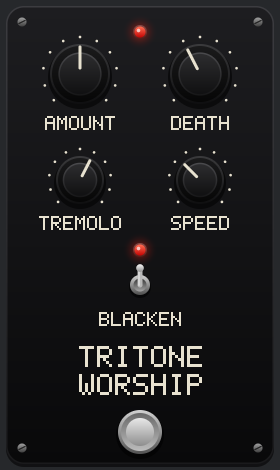

# TritoneWorship

A blackened audio effect based on stacked minor thirds.



TritoneWorship copies your sound up in minor thirds, each copy quieter than the last, up to about
18 kHz. On top of that it can add a death octave below, a black metal EQ with distortion, and a
tremolo that imitates tremolo picking. It is written in C and comes as CLAP, VST3, LV2 and a native
LMMS effect.

## Controls

| Control | Range | What it does |
|---|---|---|
| Amount | 0-100 | How much each minor third is cut. 0 cuts each step by 70%, 100 keeps every step at full level. |
| Death | 0-100 | Adds the sound an octave below, with three minor thirds stacked on it. 0 is off, 1-100 runs from -28 dB to 0 dB. |
| Blacken | on/off | Soft-clip distortion and an EQ tuned to sound like a badly recorded black metal demo. The light above the switch shows when it is on. |
| Tremolo | 0-100 | Tremolo picking depth. 0 is off, 1-100 is 30-100% depth. |
| Speed | 666-1666 BPM | Tremolo picking speed. |
| Footswitch | on/off | Bypass. The light at the top is lit while the effect is engaged. |

Drag a knob up or down to turn it. Click the Blacken switch or the footswitch to flip it.

The effect adds 1792 samples of latency (about 37 ms at 48 kHz), which it reports to the host so
the host can compensate.

## Download

| Platform | Formats | Download |
|---|---|---|
| Linux x86_64 | CLAP, VST3, LV2, native LMMS | [tritone-worship-linux-x86_64.zip](https://github.com/neilh23/tritone-worship/raw/main/binaries/tritone-worship-linux-x86_64.zip) |
| Windows x86_64 | CLAP, VST3, LV2 | [tritone-worship-windows-x86_64.zip](https://github.com/neilh23/tritone-worship/raw/main/binaries/tritone-worship-windows-x86_64.zip) |
| macOS | - | No binaries yet; see [Building on macOS](#macos-untested) |

The same files are unpacked in [binaries/](binaries/) if you only want one format.

### Installing on Linux

Unzip, then copy what your host uses:

| Format | Copy | To |
|---|---|---|
| CLAP | `tritone_worship.clap` | `~/.clap/` |
| VST3 | the `tritone_worship.vst3` folder | `~/.vst3/` |
| LV2 | the `tritone_worship.lv2` folder | `~/.lv2/` |
| LMMS | `libtritoneworship.so` | `~/lmms/plugins/` |

Then rescan plugins in your host. The binaries need glibc 2.35 or newer (Ubuntu 22.04, Debian 12
or later) and X11 or XWayland for the pedal window.

The native LMMS plugin is built against the LMMS 1.3.0-alpha nightly (git 89fc6c9). Native
plugins depend on LMMS internals, so other LMMS versions may need it rebuilt against their own
headers. The LV2 version works in any LMMS with LV2 support, without the pedal
window.

### Installing on Windows

Unzip, then copy what your host uses:

| Format | Copy | To |
|---|---|---|
| CLAP | `tritone_worship.clap` | `C:\Program Files\Common Files\CLAP\` |
| VST3 | the `tritone_worship.vst3` folder | `C:\Program Files\Common Files\VST3\` |
| LV2 | the `tritone_worship.lv2` folder | `%APPDATA%\LV2\` |

Then rescan plugins in your host. The Windows build is cross-compiled from Linux and tested under
Wine, but has not yet been tried on a real Windows machine.

## Building

### Linux

You need a C compiler, make and the X11 headers. On Debian or Ubuntu:

```sh
sudo apt install build-essential libx11-dev
make            # CLAP, VST3 and LV2 into build/linux/
make test       # unit tests, plus test hosts that load the CLAP and VST3 plugins
```

The GUI tests need an X display and are skipped without one. To install into your home directory:

```sh
make install-clap install-vst3 install-lv2
```

The native LMMS plugin is built separately. The first build downloads the matching LMMS, Qt and
libsamplerate headers into `third_party/`, using `git` and `apt-get download` (no root needed):

```sh
make lmms
make install    # copies the LMMS plugin to ~/lmms/plugins/
```

### Windows, cross-compiled from Linux

With Podman or Docker installed, this builds in a container with MinGW-w64, so nothing else needs
installing. If Wine is installed it also runs the tests on the Windows build, in a Wine prefix of
its own under `build/wine`:

```sh
make cross-windows    # CLAP, VST3 and LV2 into build/windows/
```

If you have MinGW-w64 installed yourself (`sudo apt install gcc-mingw-w64-x86-64`), you can skip
the container:

```sh
make PLATFORM=windows
make PLATFORM=windows test    # runs the tests under Wine
```

`make binaries` rebuilds everything in `binaries/`: the Linux build, the LMMS plugin and the
Windows build, with all tests run on each.

### Windows (untested)

These steps have not been tried yet. Install [MSYS2](https://www.msys2.org/), open the
"MSYS2 MINGW64" shell and run:

```sh
pacman -S make mingw-w64-x86_64-gcc
make
make test
make install-clap install-vst3 install-lv2
```

This installs into `%LOCALAPPDATA%\Programs\Common\CLAP` and `...\VST3` and `%APPDATA%\LV2`, the
per-user folders that most hosts search.

### macOS (untested)

These steps have not been tried yet, and the pedal window code for macOS has never been compiled.
Install the Xcode command line tools, then build:

```sh
xcode-select --install
make
make test
make install-clap install-vst3 install-lv2
```

This builds universal binaries for Intel and Apple Silicon, ad-hoc signs the bundles so they load
on your own Mac, and installs them into `~/Library/Audio/Plug-Ins/`. The GUI tests are skipped on
macOS. Bundles you give to other people would need signing with an Apple Developer ID and
notarising.

### EQ tuning build

`make EQ_TUNING=1` (into `build/<platform>-eq-tuning/`) exposes the 20 Blacken EQ bands as
parameters, for tuning the EQ by ear. Release builds leave them out.

## Trying it out in LMMS

`lmms/tritone_test.mmp` is a small LMMS project with a saw synth running through the native
effect. Open it, play the keyboard and turn the knobs.

## Source layout

| Path | Contents |
|---|---|
| `src/tw_dsp.c` | The effect: phase vocoder pitch stacking, death octave, Blacken, tremolo picking, bypass |
| `src/tw_ui.c` | Draws the pedal into a pixel buffer, shared by every format |
| `src/tw_gui_x11.c`, `tw_gui_win32.c`, `tw_gui_cocoa.m` | The pedal window on each platform |
| `src/tw_clap.c`, `tw_vst3.c`, `tw_lv2.c`, `lmms/` | One wrapper per plugin format |
| `test/` | Unit tests and the CLAP and VST3 test hosts |
| `third_party/` | CLAP, VST3 C API and LV2 headers |

## Licence

TritoneWorship is released into the public domain under [the Unlicense](LICENSE).

The headers in `third_party/` keep their own licences: CLAP (MIT), the VST3 C API (BSD 3-clause)
and LV2 (ISC). The native LMMS plugin is built against LMMS and Qt headers, which are downloaded at
build time and not included here. Because LMMS is GPL, the LMMS plugin binary
(`libtritoneworship.so`) is distributed under the GNU GPL version 2 or later.
